# System Architecture, Deployment & Data-Flow Diagrams

All diagrams are derived from `docker-compose.yml`, the mediator source, the
`keycloak/` scripts and `jempi-config/`. Diagram-as-code (Mermaid) so they stay
maintainable.

Notation:

- **Architecture diagrams** — components, containers, protocols, ports.
- **DFD** — squared nodes = external entities, rounded = processes,
  `[( )]` = data stores, labelled arrows = data flows. DFD notation is kept
  separate from architecture notation.

---

## 1. Component summary

| Component | Image / source | Role | Host port(s) |
|---|---|---|---|
| OpenHIM Core | `jembi/openhim-core:latest` | client auth (Basic + Keycloak JWT), channel routing, transaction log | `8080` API, `5000` HTTPS tx, `127.0.0.1:5001` HTTP tx |
| OpenHIM Console | `organsushi/medisha-him:latest` | admin web UI | `9000` |
| MongoDB | `mongo:4.0` | OpenHIM datastore (clients, channels, transactions) | none |
| HAPI FHIR | `hapiproject/hapi:latest` | FHIR R4 clinical store + Tester UI | `127.0.0.1:8081` |
| HAPI Postgres | `postgres:16-alpine` | HAPI relational store (`hapi`) + `admin_review` DB | none |
| Keycloak | `quay.io/keycloak/keycloak:26.7.2` | RS256 JWT issuer, realm `openhie` | `127.0.0.1:8083` |
| `mediator` (FHIR MPI Orchestrator) | `./services/fhir-mediator`, Node 20 | Patient to JeMPI to HID to HAPI upsert; other resources pass-through | internal `:4000` |
| `fhir-intake-mediator` | `./services/fhir-intake-mediator` | `POST /ingest`: CDRS row to Bundle to orchestrator; FHIR pass-through | internal `:4003` |
| `admin-mediator` | `./services/admin-mediator` | duplicate review queue + merge in JeMPI **and** HAPI | internal `:4002` |
| `patient-portal-mediator` | `./services/patient-portal-mediator` | read-only patient-scoped aggregate over HAPI | internal `:4001` |
| Caddy (`caddy` / `caddy-ip`) | `caddy:2-alpine` | reverse proxy + automatic TLS, **VPS only**, profiles `vps` / `vps-ip` | `80`, `443` |
| JeMPI | **external** — `202.51.71.81`, `:50000` open / `:50001` Keycloak | master patient index: golden records, deterministic + probabilistic linking | none |

Not in this repo (referenced only): the admin duplicate-review **UI**
(`admin_portal`) and the **CDRS dump script** (`FHIR_mediator/`).

---

## 2. Logical architecture

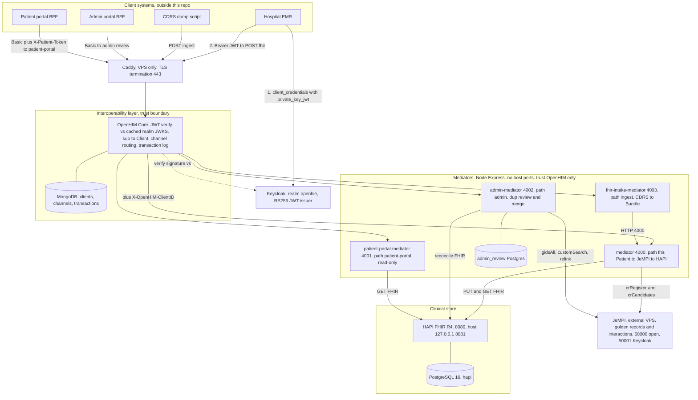

### Boundaries

| Boundary | Enforced by |
|---|---|
| Internet vs stack | Caddy (VPS) + host firewall — only `80`/`443` public in `vps` mode |
| Client vs mediator | **OpenHIM only** — mediators have no auth of their own; no mediator publishes a host port |
| Auth verification | OpenHIM vs the realm JWKS (`authentication_jwt_jwksUri`) — RS256, keys cached in-process, refetched only on an unknown `kid` |
| Facility identity | OpenHIM-set `X-OpenHIM-ClientID` — not forgeable; equals the NHFR code |
| Patient scoping (portal) | `patient-portal-mediator` verifies the forwarded `X-Patient-Token` and pins to one golden UID |
| Identity plane vs clinical plane | mediator orchestration — JeMPI resolves *who*, HAPI stores *what*; reads never touch JeMPI |

### Protocols and ports

| Link | Protocol | Port |
|---|---|---|
| EMR to Keycloak | HTTPS (VPS) / HTTP (local) | 443 / 8083 |
| EMR to OpenHIM tx | HTTPS | 443 (Caddy to 5001) / 5000 (self-signed) |
| OpenHIM to mediator | HTTP | 4000/4001/4002/4003 (internal) |
| mediator to JeMPI | HTTP | 50000 (`10.8.0.1` via WireGuard, or public IP) |
| mediator to HAPI | HTTP | 8080 (`fhir:8080` internal) |
| mediator to OpenHIM API | HTTPS self-signed | 8080 |
| admin-mediator to Postgres | TCP | 5432 (`hapi-db` internal) |
| OpenHIM to Mongo | TCP | 27017 (internal) |

---

## 3. Deployment architecture (VPS)

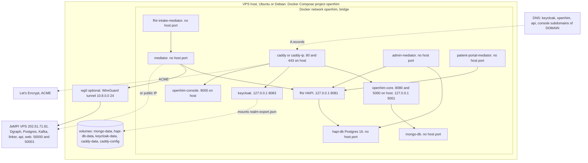

Notes: single host, one Compose project (`name: openhim`); no orchestrator, no
replicas; every service `restart: unless-stopped`. Bind mounts:
`application.yaml` + `np.core-1.0.0.tgz` to
fhir; `realm-export.json` to keycloak; `jempi-config/` to admin-mediator
(read-only `/config`); each mediator's source dir to its container (`node
--watch` dev bind mount). Caddy is profile-gated.

---

## 4. Network / request flow — Patient write

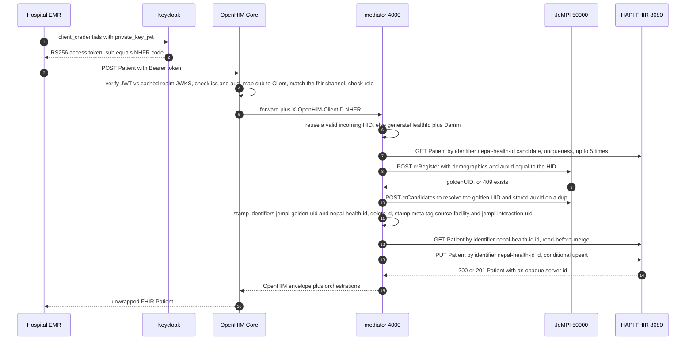

---

## 5. DFD Level 0 — Context

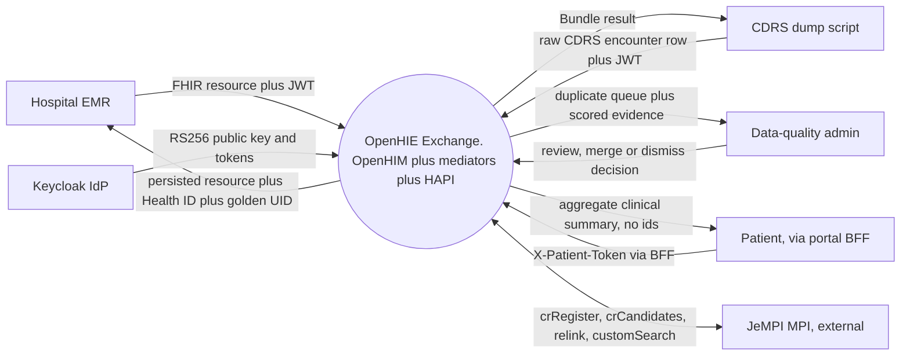

---

## 6. DFD Level 1 — Major processes

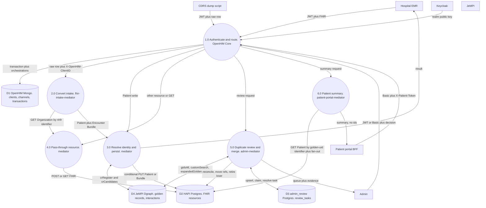

---

## 7. DFD Level 2 — Patient registration (process 3.0)

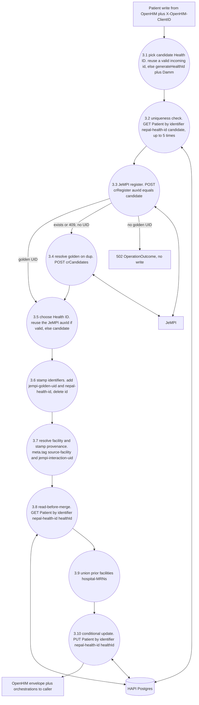

---

## 8. DFD Level 2 — CDRS intake (process 2.0)

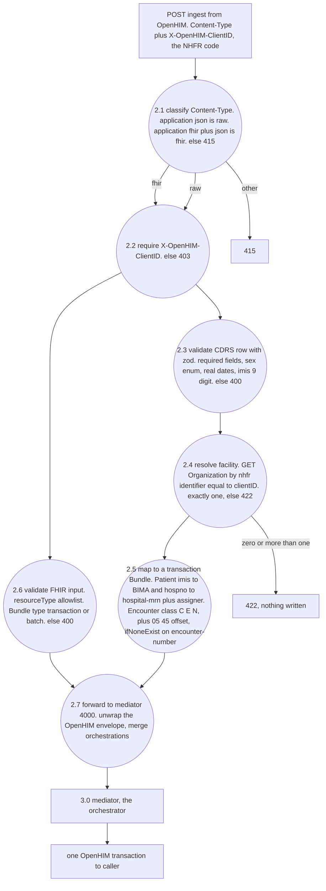

---

## 9. DFD Level 2 — Duplicate detection and merge (process 5.0)

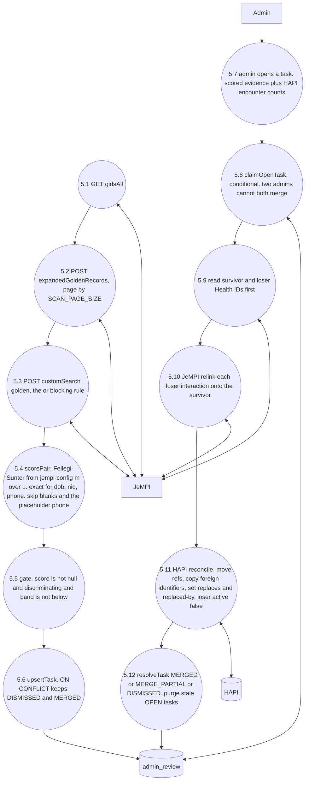

---

## 10. DFD Level 2 — Patient search / portal summary (process 6.0)

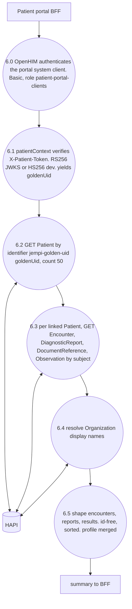

Also `GET /patient-portal/resolve?healthId=|phone=` (system-authed, no
`X-Patient-Token`): returns `{ goldenUid, phone, displayName }` for the BFF to
send an OTP — no clinical data.

---

## 11. Patient identity lifecycle (state)

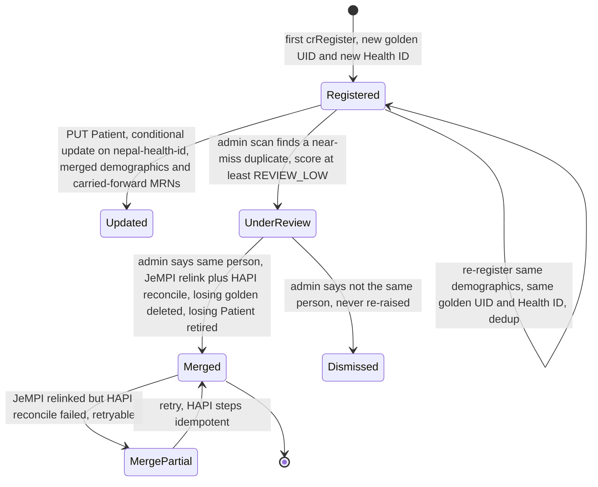

No split operation exists; a wrong merge is effectively irreversible.

---

## 12. Database ERD

The only application-owned relational schema in this repo is
`admin_review.review_tasks` (`services/admin-mediator/src/db/pool.ts`). HAPI's ~150 tables
are managed by HAPI itself (Hibernate; Flyway disabled).

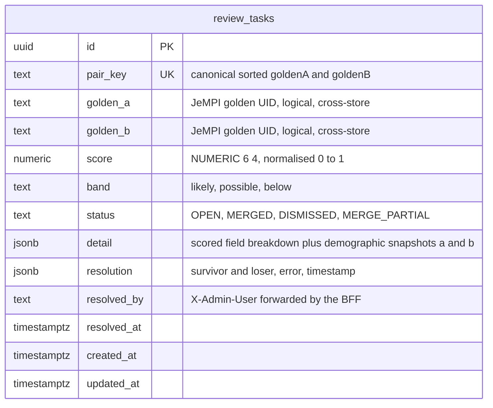

Indexes: `(status, score DESC)`, `(golden_a, golden_b)`. `golden_a` / `golden_b`
reference JeMPI golden records in a different datastore — no FK.

---

## 13. Trust boundaries

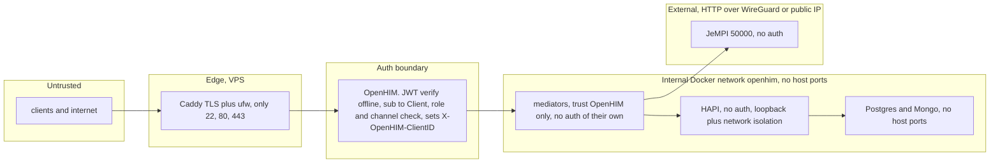

`patient-portal-mediator` additionally verifies `X-Patient-Token` and pins each
request to one golden UID, so a correctly authenticated portal can still only
read the patient who logged in.

---

## 14. Written walk-through

A client obtains an RS256 JWT from Keycloak (hospitals via `private_key_jwt`
client-credentials; the demo user via password grant; the two BFFs via OpenHIM
Basic auth). It sends the JWT as `Authorization: Bearer` on every request to
OpenHIM Core's transaction port. OpenHIM verifies the signature against the
realm JWKS (cached; refetched on an unknown `kid`), checks `iss`/`aud`, maps the token `sub` to a
registered OpenHIM **Client**, matches the URL against a **channel**, checks the
Client's role against the channel's `allow` list, and forwards to the mediator on
the internal Docker network — injecting the non-forgeable `X-OpenHIM-ClientID`.

Each mediator owns one URL space:

- **`mediator`** (`/fhir`) — for a Patient write it resolves identity through
  JeMPI: mint or reuse the Damm-checked Nepal Health ID, obtain the golden UID
  from `crRegister` (resolving via `crCandidates` on a deterministic duplicate),
  stamp both identifiers plus `source-facility` / `jempi-interaction-uid`
  provenance, read-merge any existing HAPI record (carrying forward other
  facilities' MRNs), and do an idempotent conditional `PUT` keyed on the Health
  ID identifier. Other resources pass through with light enrichment
  (conditional-reference resolution, Practitioner identifier dedup,
  DocumentReference Binary upload). GET searches forward to HAPI unchanged and
  never call JeMPI.
- **`fhir-intake-mediator`** (`/ingest`) — converts one raw CDRS encounter row to
  a Patient+Encounter transaction Bundle (resolving the facility Organization by
  the trusted `X-OpenHIM-ClientID` NHFR code, requiring exactly one match), or
  passes supported FHIR JSON through, then forwards to `mediator:4000` and merges
  the downstream orchestrations into one OpenHIM transaction.
- **`admin-mediator`** (`/admin`) — scans JeMPI golden records for near-miss
  duplicates the deterministic write path never flags, scores them with
  Fellegi-Sunter weights read from the *deployed* JeMPI link config, queues them
  in its own Postgres DB, and on an admin decision merges a pair in JeMPI
  (`/relink`) then reconciles HAPI (repoint clinical records, carry foreign
  identifiers, retire the loser with `replaced-by`).
- **`patient-portal-mediator`** (`/patient-portal`) — read-only. After OpenHIM
  authenticates the portal BFF it independently verifies the forwarded
  per-patient `X-Patient-Token`, pins the request to that patient's golden UID,
  fans out across every linked HAPI Patient, and returns a merged, id-free
  summary.

Every mediator reply is an OpenHIM response envelope
(`application/json+openhim`), so OpenHIM logs every downstream call as an
orchestration and returns only the inner body to the client. The OpenHIM
transaction log is therefore both the audit record and the live flow diagram.
