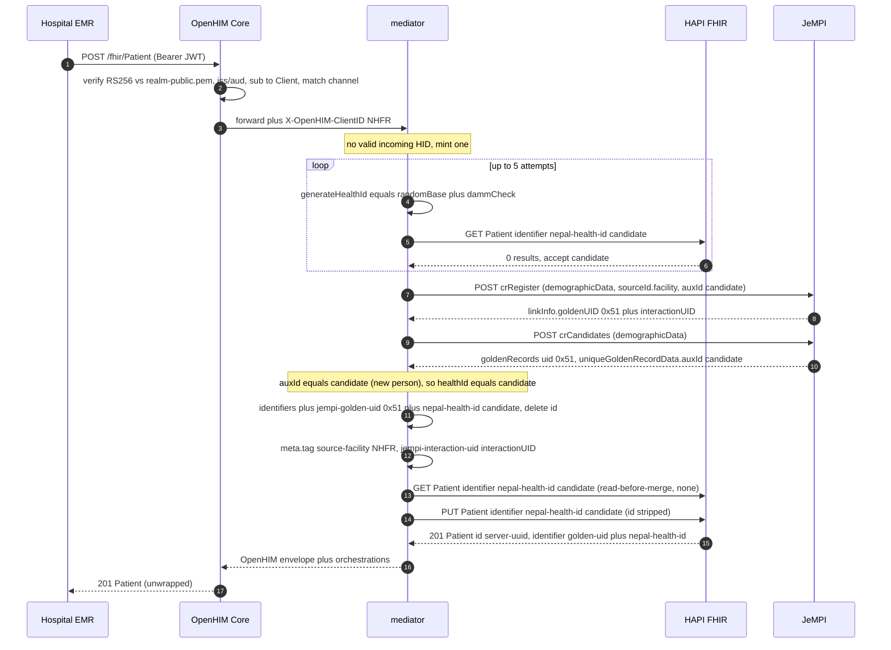
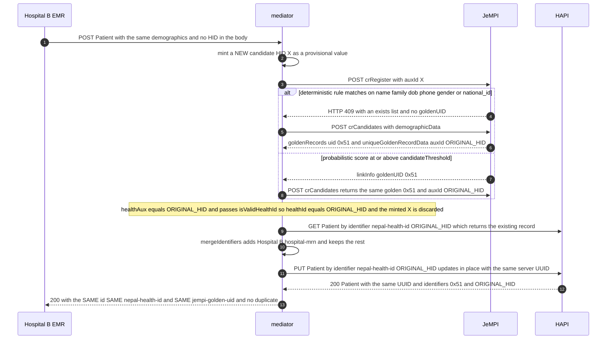
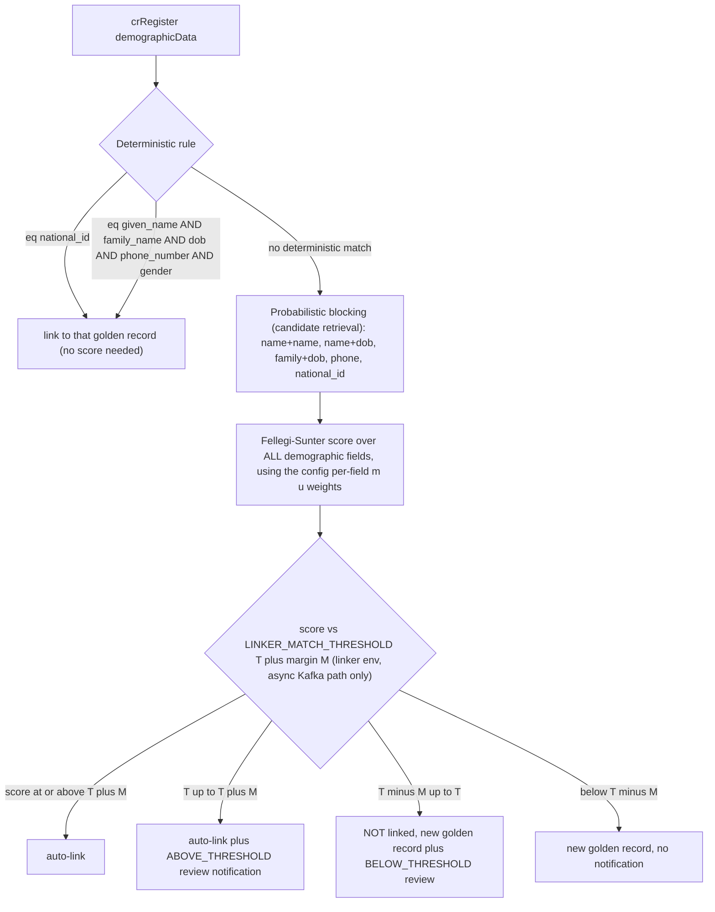
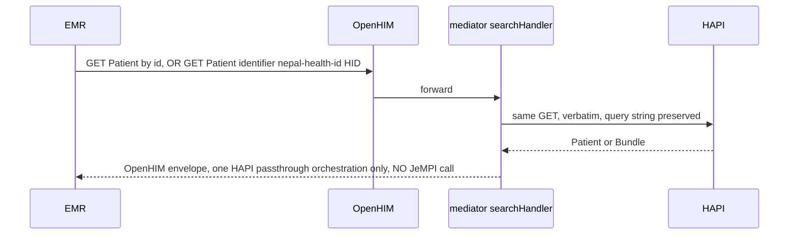
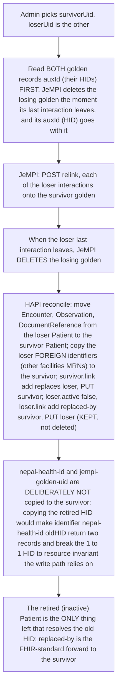

# Nepal Health ID (HID) — Generation & Resolution Flow

## 1. The two identifiers

Every patient carries **two** identifiers, mapped 1:1:

| Identifier | System URI | Made by | Role |
|---|---|---|---|
| **Nepal Health ID** ("HID") | `http://mohp.gov.np/fhir/NamingSystem/nepal-health-id` | the mediator — `mediator/src/fhir/healthId.js` `generateHealthId()` | human-facing lifetime number; also the key for the HAPI conditional upsert |
| **JeMPI golden UID** | `http://mohp.gov.np/fhir/NamingSystem/jempi-golden-uid` | JeMPI — returned by `POST /crRegister` | machine-side cross-source dedup key (a Dgraph hex id, e.g. `0x51`) |

> **The mediator mints the HID; JeMPI only stores it** (as the golden record's
> `auxId`) so it round-trips on re-registration. The 1:1 mapping is maintained by
> the mediator, not enforced by either store.
> Source: `mediator/src/fhir/healthId.js` header, `DEMO.md` "Health ID".

## 2. HID format & check digit

Source: `mediator/src/fhir/healthId.js`.

- **10 random digits**, first digit 1–9 (`randomBase()`), then
- **+1 Damm check digit** (`dammCheck()` — a 10×10 totally anti-symmetric
  quasigroup table). Total length **11**.
- Encodes **nothing** about the patient — no DOB, gender, or facility.
- Validation: `isValidHealthId(v)` = string, `^\d{11}$`, `dammValid(v)` (the
  Damm fold over all 11 digits returns 0).
- **Damm over Luhn**: Damm catches every single-digit error *and* every adjacent
  transposition (`07`↔`70`, twin-digit swaps) with one table — Luhn misses
  twin-digit swaps. A mistyped HID is rejected client-side with no DB lookup.

> A planned alphanumeric format (`AA481242` + Damm digit) exists as a design in
> `docs/superpowers/plans/2026-08-28-alphanumeric-health-id-damm-plan.md` but is
> **not implemented** — the code is still numeric-11. This document describes the
> current behaviour.

## 3. Where it happens

Trigger: any Patient write — `POST /fhir/Patient` or a `transaction`/`batch`
Bundle with Patient entries — through OpenHIM.

| Component | File |
|---|---|
| route + auth + `X-OpenHIM-ClientID` | OpenHIM Core (`docker-compose.yml` `authentication_*`) |
| handler | `mediator/src/handlers/patient.js` / `mediator/src/handlers/bundle.js` |
| identity resolution (mint/reuse HID, golden UID, provenance, read-merge) | `mediator/src/fhir/patientIdentity.js` `resolvePatientIdentity()` |
| HID generation + validation | `mediator/src/fhir/healthId.js` |
| JeMPI calls + FHIR→JeMPI mapping | `mediator/src/providers/jempiProvider.js` |
| HAPI I/O (conditional update, searches) | `mediator/src/fhir/hapiClient.js` |
| `meta.tag` provenance | `mediator/src/fhir/provenance.js` |

---

## 4. Master flow — generation & JeMPI resolution

```mermaid
flowchart TD
 A["POST Patient via OpenHIM. JWT verified, sub mapped to Client, X-OpenHIM-ClientID injected"] --> B{"Patient body already carries a nepal-health-id identifier that passes isValidHealthId"}
 B -- yes --> C["candidateHealthId equals that value"]
 B -- no --> D["mintUniqueHealthId: loop up to 5 times. generateHealthId equals randomBase (10 digits, first 1 to 9) plus dammCheck. GET Patient by identifier nepal-health-id candidate. Accept the first candidate with NO match"]
 C --> E["JeMPI POST crRegister. demographicData: given, family, gender, dob YYYYMMDD, city, phone, nationalId. sourceId.facility equals resolveFacility of clientId. uniqueInteractionData.auxId equals candidateHealthId. candidateThreshold equals JEMPI_CANDIDATE_THRESHOLD 0.9"]
 D --> E

 E --> F{"crRegister response"}
 F -- "body has goldenUID (new golden or probabilistic link)" --> G["linked equals that golden UID. POST crCandidates demographicData, read the golden stored auxId back"]
 F -- "200 with exists list, no UID (deterministic dup)" --> H["POST crCandidates, take the top golden uid plus its auxId"]
 F -- "HTTP 409 with exists list, no UID (deterministic dup)" --> H
 F -- "no UID, no exists" --> Z1["502 OperationOutcome, JeMPI register failed. NOTHING written to HAPI"]
 H -- "crCandidates still returns no golden UID" --> Z2["502, deterministic dup could not be resolved to a golden UID"]

 G --> I{"golden stored auxId healthAux passes isValidHealthId"}
 H --> I
 I -- yes --> J["healthId equals healthAux. RETURNING person, reuse the HID JeMPI already holds for this golden record"]
 I -- no --> K["healthId equals candidateHealthId. BRAND-NEW person"]

 J --> L["strip any existing nepal-health-id and jempi-golden-uid from the body. append jempi-golden-uid equals goldenUid. append nepal-health-id equals healthId. delete Patient.id"]
 K --> L
 L --> M["resolveFacility of clientId: FACILITY_REGISTRY_JSON entry, else clientId itself, else payload managingOrganization, else JEMPI_DEFAULT_FACILITY. stampProvenance: meta.tag jempi-interaction-uid if any, plus source-facility"]
 M --> N["GET Patient by identifier nepal-health-id healthId (read-before-merge). If a record exists, mergeIdentifiers: hospital-mrn unioned by system and value so prior facilities MRNs carry forward; every other system, the incoming body is authoritative, an existing value only backfills a system the body omits"]
 N --> O["PUT Patient by identifier nepal-health-id healthId (id stripped). HAPI creates with a fresh UUID if none matches, updates the single match in place, 412 if two match"]
 O --> P{"HAPI ok"}
 P -- no --> Z3["502, HAPI write failed with status. orchestration recorded"]
 P -- yes --> Q["OpenHIM envelope application json+openhim: HAPI Patient (opaque UUID id) plus full orchestration list. OpenHIM unwraps, returns to caller"]
```



---

## 5. Sequence view (the happy path)



---

## 6. Re-registration of the SAME person (dedup → HID is REUSED)

Re-POST the same demographics (name + dob + phone + gender; optionally from a
different hospital token).



Key points:

- The candidate HID minted on the second request is **provisional** — it is only
  used as `auxId` on the `crRegister` call and is thrown away the moment
  `crCandidates` returns the golden record's stored `auxId`
  (`patientIdentity.js:33` — `healthId = isValidHealthId(link.healthAux) ?
  link.healthAux : candidateHealthId`).
- `crCandidates` is a **consistent Dgraph read**, unlike a HAPI search that could
  still be lagging — that is why the reused HID is resolved through JeMPI, not
  through HAPI (`patientIdentity.js` comment; `providers/jempiProvider.js`
  `lookupGolden()`).
- The deterministic-dup (409 `exists`) path yields **no interaction UID** — JeMPI
  does not persist an interaction for it — so `jempi-interaction-uid` may be
  absent from `meta.tag` on that write (`provenance.js` comment).

---

## 7. What decides "same person" in JeMPI

Applied on the JeMPI host from `jempi-config/config-reference-link-dp.json` (see
`VPS-DEPLOYMENT.md` §6).



> **On this deployment the write path uses `POST /crRegister`, which is a
> synchronous *deterministic* find-or-create.** It never runs the probabilistic
> scorer and never emits a review notification, so JeMPI's own review queue is
> permanently empty. The threshold band above only applies to JeMPI's async
> Kafka path. Near-miss duplicates are found and resolved by the
> **`admin-mediator`** instead (§9).
> Source: `admin-mediator/README.md`, `jempi-config/README.md`.

`candidateThreshold` (the `mediator` env `JEMPI_CANDIDATE_THRESHOLD`, default
`0.9`, sent on `crRegister`) is the confidence needed to link *synchronously* to
an existing golden record; below it, `crRegister` creates a new golden record.

---

## 8. Read-back — the HID resolves without JeMPI



At read time identity was already resolved at write time; the HID **is** the
lookup key. `DEMO.md` §9: "Reads bypass JeMPI entirely; by read-time the Health
ID *is* the HAPI resource id [key]."

The **patient portal** resolves by golden UID instead:
`GET /Patient?identifier=jempi-golden-uid|<gid>` returns *every* linked Patient
record, then the portal fans out and merges their encounters/reports/documents
(`patient-portal-mediator/src/handlers/patientPortal.js`).

---

## 9. Effect of an admin merge on the HID

When the `admin-mediator` merges a confirmed duplicate pair
(`admin-mediator/src/services/mergeService.js`):



- **No split operation exists.** A wrong merge is effectively irreversible —
  which is why the admin scorer is deliberately stricter than stock JeMPI
  (exact-match on `dob`/`national_id`/`phone_number`, placeholder phone treated
  as blank).
- If JeMPI relinks but HAPI reconciliation fails, the task is `MERGE_PARTIAL` —
  identity is already correct in JeMPI; retry (every HAPI step is idempotent).

---

## 10. Failure map

| Failure | Where | Result |
|---|---|---|
| JeMPI unreachable / timeout | `registerInteraction` catch | `502` OperationOutcome, **no HAPI write** — HID not persisted |
| `crRegister` returns no golden UID and no `exists` | `resolvePatientIdentity` | `502` `no goldenUid returned` |
| deterministic dup, `crCandidates` yields no golden UID | `jempiProvider` | `502` `deterministic dup could not be resolved to a golden UID` |
| HID uniqueness search errors | `mintUniqueHealthId` | candidate accepted anyway (the conditional `PUT` still 412s on a real dup) |
| HAPI conditional update fails (412 / down) | `patient.js` catch | `502` with the HAPI status + a body slice; orchestration recorded |
| incoming `nepal-health-id` present but not Damm-valid | `patientIdentity.js` | ignored — a fresh HID is minted |

Every downstream call — success or failure — is recorded as an **orchestration**
on the OpenHIM transaction (`orch()` in `mediator/src/lib/orchestration.js`),
visible in Console → Transactions.

---

## 11. Prove it (synthetic data)

```bash
TOKEN=$(./keycloak/get-jwt-client-token.sh 3130400221)
BODY='{"resourceType":"Patient","name":[{"family":"SHRESTHA","given":["KAMANA"]}],
       "gender":"female","birthDate":"2001-06-25",
       "telecom":[{"system":"phone","value":"9800000000"}],"address":[{"city":"Bharatpur"}]}'

# first registration → new HID + new golden UID
curl -k -sS -X POST https://localhost:5000/fhir/Patient \
  -H "Authorization: Bearer $TOKEN" -H 'Content-Type: application/fhir+json' -d "$BODY" \
  | jq '{id, identifier, tags: .meta.tag}'

# re-registration (any hospital token) → SAME HID + SAME golden UID, no duplicate
TOKEN2=$(./keycloak/get-jwt-client-token.sh 3130400225)
curl -k -sS -X POST https://localhost:5000/fhir/Patient \
  -H "Authorization: Bearer $TOKEN2" -H 'Content-Type: application/fhir+json' -d "$BODY" \
  | jq '{id, identifier}'

# HID standalone (generator + Damm)
docker exec mediator node -e "import('./src/fhir/healthId.js').then(m=>{const id=m.generateHealthId();console.log(id,'Damm-valid:',m.isValidHealthId(id))})"
```
