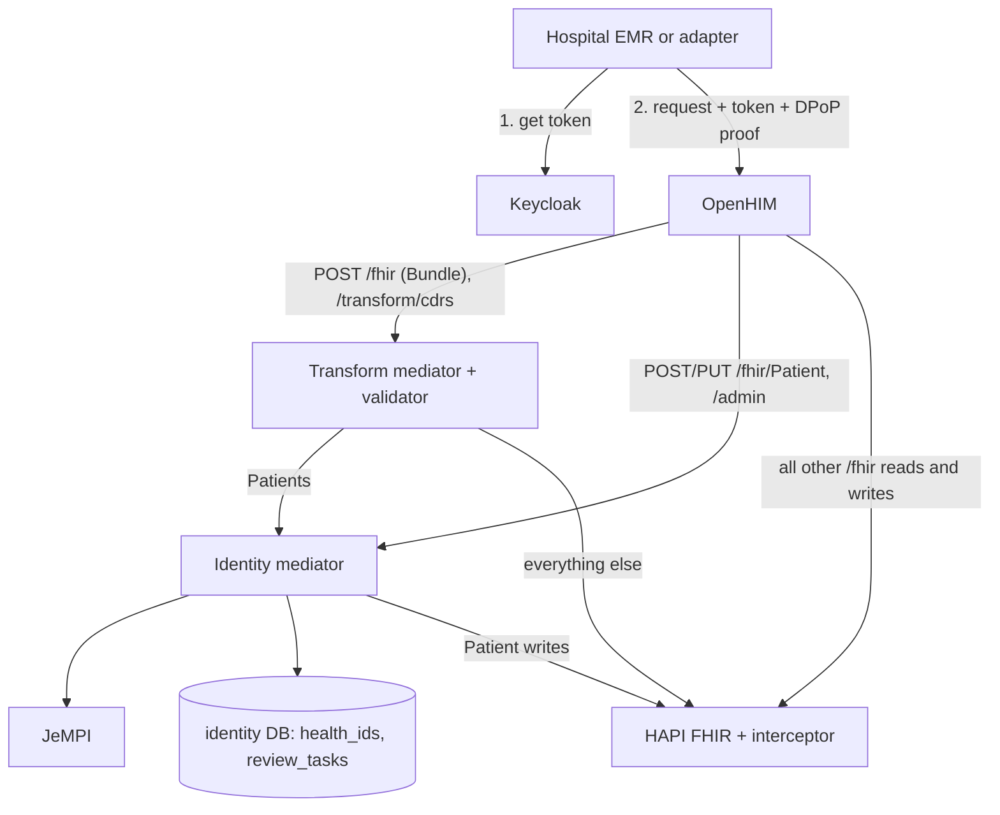
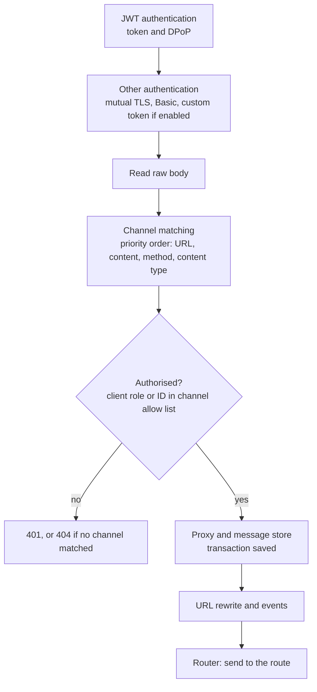
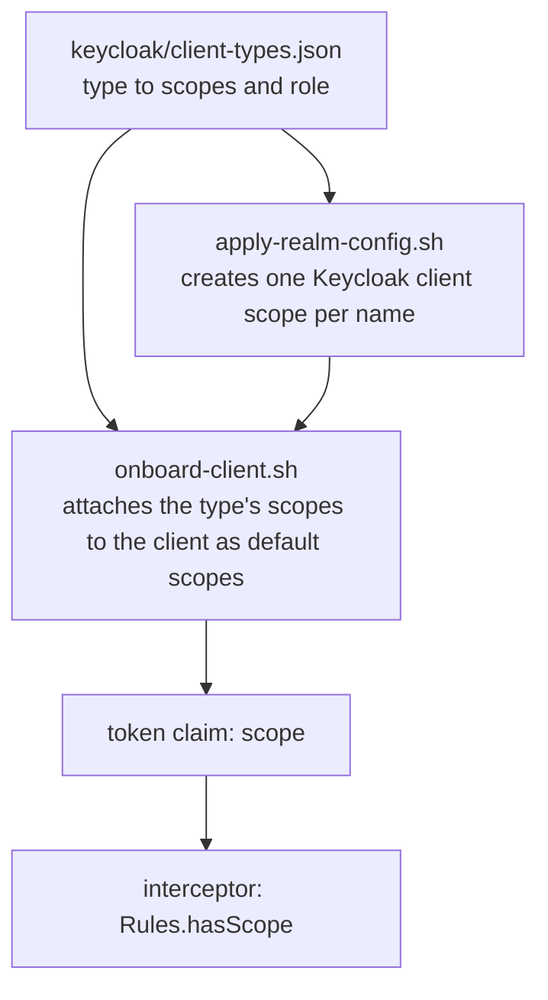
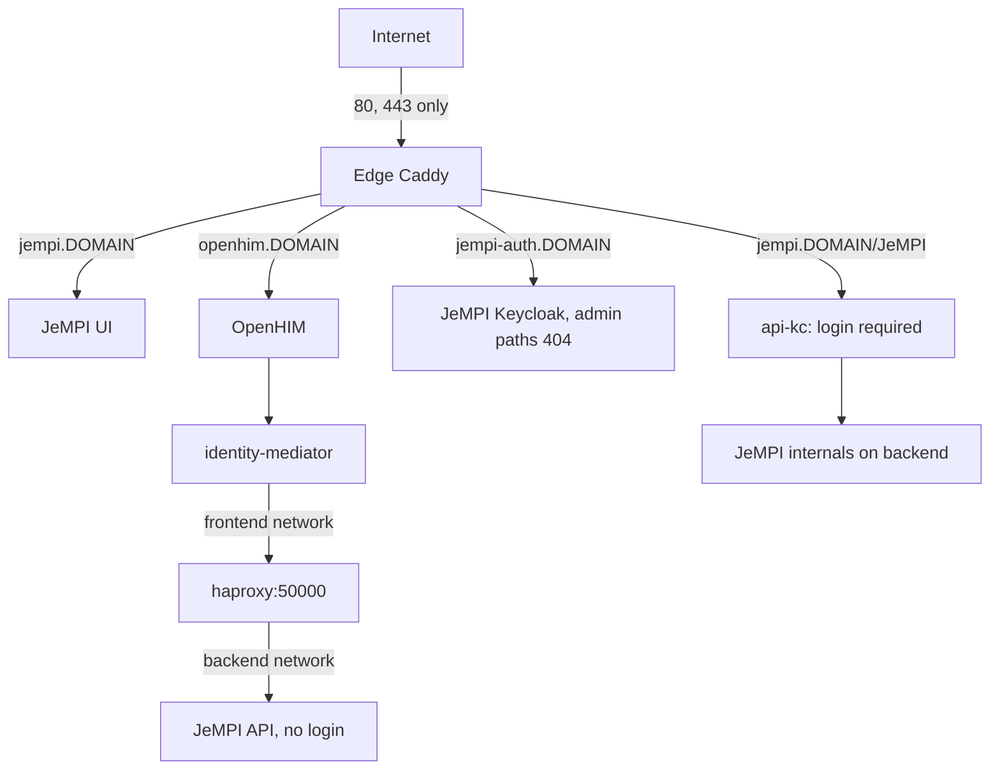
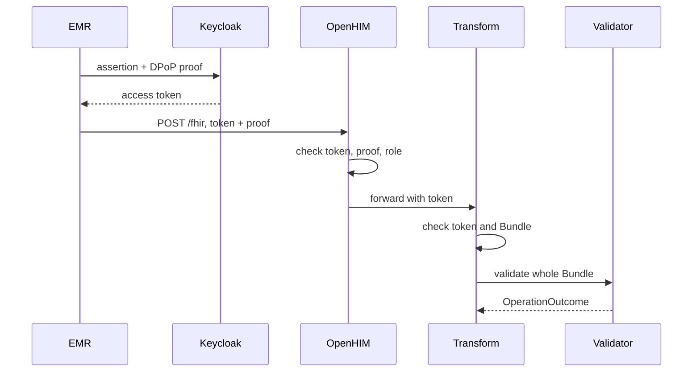
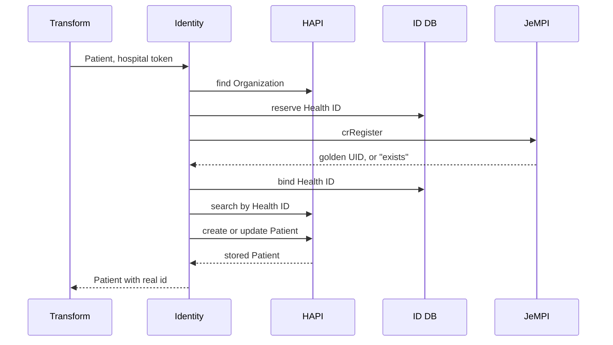
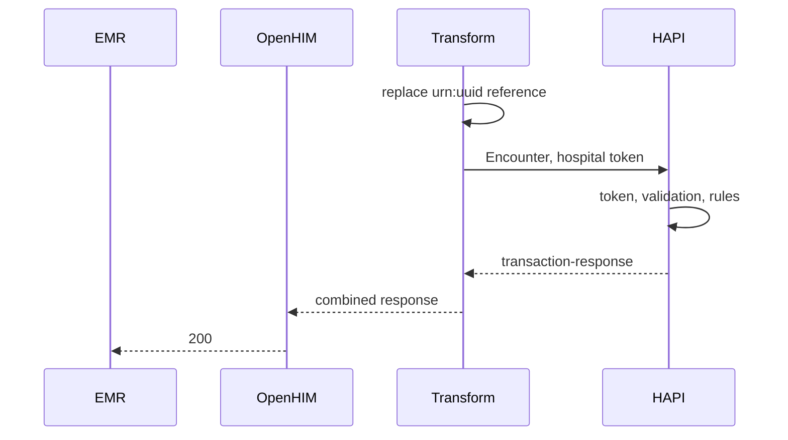
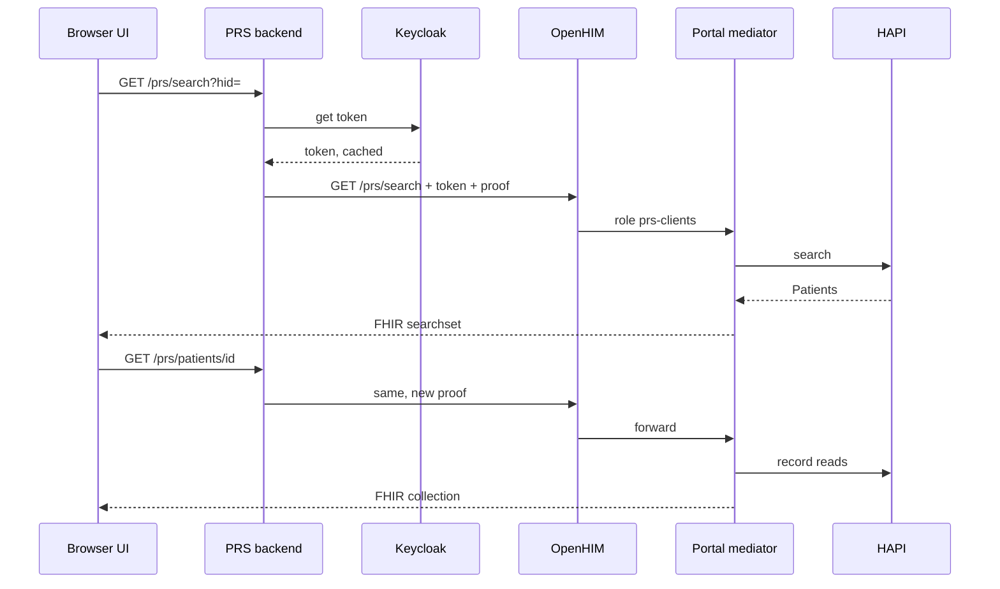

# How this platform works, end to end

Written 2026-11-26 from the source in `openhie`, `openhim_single`, `FHIR_mediator`,
`openhim-core-js`, `openhim-console` and the local `JeMPI` fork. Nothing here comes
from running the stack. Statements that come from documentation rather than code are
marked.

Contents

1. [The big picture](#1-the-big-picture)
2. [Words you need first](#2-words-you-need-first)
3. [The components](#3-the-components)
4. [Login and DPoP](#4-login-and-dpop)
5. [OpenHIM: the front door](#5-openhim-the-front-door)
6. [Validation](#6-validation)
7. [The HAPI interceptor](#7-the-hapi-interceptor)
8. [The identity mediator](#8-the-identity-mediator)
9. [The transform mediator](#9-the-transform-mediator)
10. [JeMPI: how a person is recognised](#10-jempi-how-a-person-is-recognised)
11. [Walkthrough: an EMR sends a Patient and an Encounter](#11-walkthrough-an-emr-sends-a-patient-and-an-encounter)
12. [How hospitals talk to the platform](#12-how-hospitals-talk-to-the-platform)
13. [Onboarding](#13-onboarding)
14. [Duplicate review and merge](#14-duplicate-review-and-merge)
15. [Read side: patient portal and PRS](#15-read-side-patient-portal-and-prs)
16. [Every script](#16-every-script)
17. [Where data lives](#17-where-data-lives)
18. [Problems and mismatches found while reading](#18-problems-and-mismatches-found-while-reading)

---

## 1. The big picture

Many hospitals each have their own patient numbers. The platform answers three
questions for every record that arrives:

| Question | Who answers it |
| --- | --- |
| Who is sending this, and may they? | Keycloak, OpenHIM, HAPI interceptor |
| Is the data well formed? | Transform mediator, validator, HAPI |
| Which real person is it about? | Identity mediator, JeMPI, Health ID register |



The repositories that matter:

| Repository | Holds |
| --- | --- |
| `openhie` | Source code: interceptor and mediators. CI builds images from it. |
| `openhim_single` | The real deployment: compose file, HAPI config, channels, onboarding scripts. |
| `openhim-core-js` | Fork of OpenHIM Core. Adds DPoP verification. |
| `openhim-console` | Fork of the OpenHIM web console. Nepal branding and a client-roles fix. |
| `FHIR_mediator` | The hospital-side adapter that sends data. |

## 2. Words you need first

| Word | Meaning |
| --- | --- |
| FHIR R4 | Standard JSON format for health data. A **resource** is one object (Patient, Encounter, Observation). |
| Bundle | A list of resources sent together. A `transaction` Bundle succeeds or fails as a whole inside one FHIR server. A `batch` lets entries fail alone. |
| `urn:uuid:` fullUrl | A temporary id inside a Bundle, so one entry can point at another before either has a real id. |
| Conditional create (`ifNoneExist`) | "Create this only if no resource matches this search." Makes resending safe. |
| NP Core 1.0.0 | Nepal's FHIR implementation guide: extra rules (profiles) on top of R4. Shipped as `np.core-1.0.0.tgz`. |
| NHFR code | The facility's number in the National Health Facility Registry. It is also the hospital's client ID. |
| MRN | The hospital's own patient number. |
| Health ID | National patient ID issued by this platform, for example `FH9634402`. |
| JeMPI | Master patient index. Decides whether two submissions are the same person. |
| Interaction | In JeMPI, one submission of a person's demographics. |
| Golden record | In JeMPI, the one record per person that interactions link to. Its id looks like `0x51`. |
| Mediator | A small service behind OpenHIM that does real work on a request. |
| SMART scope | A permission string in the token, such as `system/Encounter.crus`. |

### Identifier systems

An identifier is a pair: `system` (who issued it) and `value`. The code decides
meaning from `system` alone.

| System | Meaning |
| --- | --- |
| `http://fhir.digitalhealth.gov.np/core/NamingSystem/nepal-health-id` | Health ID. Issued only by the identity mediator. |
| `http://mohp.gov.np/fhir/NamingSystem/jempi-golden-uid` | JeMPI golden record id. Set only by the identity mediator. |
| `http://donidcr.gov.np` | National ID |
| `http://hib.gov.np` | Health insurance (IMIS / BIMA) number |
| `http://nhfr.digitalhealth.gov.np` | NHFR code of an Organization |
| `http://nhfr.digitalhealth.gov.np/<NHFR>` | That facility's own namespace, used for encounter numbers |
| `http://mohp.gov.np/fhir/NamingSystem/hospital-mrn/<NHFR>` | That facility's MRNs |
| `http://mohp.gov.np/fhir/NamingSystem/source-facility` | Not an identifier: a `meta.tag` naming the owning facility |
| `http://mohp.gov.np/fhir/NamingSystem/jempi-interaction-uid` | A `meta.tag` naming the JeMPI interaction |

## 3. The components

| Component | Port (deployment, loopback only) | Job | Does not do |
| --- | --- | --- | --- |
| Edge Caddy (`caddy_vps`) | 80, 443 | The only public container. HTTPS for every public hostname; hides the Keycloak admin consoles. | Any authentication |
| Keycloak | 8083 | Holds clients and their public keys. Issues 5-minute DPoP-bound tokens with scopes. | See clinical data |
| OpenHIM Core | 5000, 5001, 8080 (API) | Checks token and DPoP proof, picks a channel by URL, method and role, forwards, logs the transaction. | Understand FHIR |
| OpenHIM Console | 9000 | Web UI over the OpenHIM API | |
| Transform mediator | 4005, internal | Maps CDRS rows to FHIR, validates, splits Bundles | Store anything |
| NP Core validator | 8081 inside the transform container | HL7 `validator_cli.jar` in server mode | |
| Identity mediator | 4002, internal | Every Patient write, Health ID, duplicate review, merge | Clinical writes (except moving records in a merge) |
| JeMPI | same VPS, no published ports (section 10) | Matching and golden records | Authenticate callers of its internal API |
| HAPI FHIR 8.12 + interceptor | 8081 | Clinical store and access rules | Matching people |
| PostgreSQL (`hapi-db`) | internal | Databases `hapi`, `keycloak`, `identity` | |
| MongoDB | internal | OpenHIM configuration and transaction log | |
| Patient portal mediator | 4001, internal | Read-only patient portal and staff PRS API | Any write |

## 4. Login and DPoP

### The problem DPoP solves

A plain "Bearer" token works for whoever holds it. If someone copies it from a
log, they can use it. **DPoP** (RFC 9449) ties the token to a private key. To use
the token you must also sign a small proof for each request with that key.

### Step 1: get a token

The hospital never sends a password. It signs a short JWT (the **client
assertion**) with its private key. Keycloak checks it with the stored public key.
This is called `private_key_jwt`.

```http
POST /realms/openhie/protocol/openid-connect/token
DPoP: <proof: htm=POST, htu=<token URL>, iat, jti>

grant_type=client_credentials
client_id=3130400221
client_assertion_type=urn:ietf:params:oauth:client-assertion-type:jwt-bearer
client_assertion=<JWT: iss=sub=3130400221, aud=token URL, exp, jti>
```

Keycloak returns an access token (300 seconds). The claims that matter:

| Claim | Value | Used by |
| --- | --- | --- |
| `iss` | realm URL | OpenHIM, mediators, HAPI: must match exactly |
| `aud` | `account` | OpenHIM |
| `sub` | the client ID (a hard-coded mapper sets it) | OpenHIM looks up the client with the same ID |
| `azp` | the client ID | Mediators and HAPI take this as the caller, and as the facility |
| `scope` | `system/Patient.crus system/Encounter.crus ...` | HAPI and identity mediator |
| `cnf.jkt` | SHA-256 thumbprint of the DPoP public key | OpenHIM compares each proof against it |
| `exp` | issued time + 300 s | everyone |

The realm has a client policy (`keycloak/realm-export.json`,
`dpop-for-all-clients`) that forces DPoP on every confidential client. A token
request without a proof gets `400 DPoP proof is missing`.

### Step 2: sign a proof for every request

```json
header:  { "typ": "dpop+jwt", "alg": "RS256", "jwk": { "kty": "RSA", "n": "...", "e": "AQAB" } }
payload: { "htm": "POST",
           "htu": "https://openhim.<DOMAIN>/fhir",
           "iat": 1790668950,
           "jti": "<new random value>",
           "ath": "<base64url SHA-256 of the access token>" }
```

```http
Authorization: DPoP <access token>
DPoP: <proof>
```

### What OpenHIM checks, in order

Source: `openhim-core-js/src/middleware/jwtAuthentication.js` and `src/dpop.js`.

First the token, in `authenticateToken`:

1. The `Authorization` header must be `Bearer <jwt>` or `DPoP <jwt>`.
2. Signature, allowed algorithm (`RS256` here), `issuer`, `audience` and expiry. The signing key comes from the realm JWKS.
3. The token must have a `sub`.
4. If the token has `cnf.jkt` **and** `authentication.jwt.dpopPublicBaseUrl` is set, `verifyDpop` runs.
5. An OpenHIM client with `clientID` equal to `sub` must exist.

Then `verifyDpop`:

| # | Check | Error written to the core log | Stops |
| --- | --- | --- | --- |
| 1 | A `DPoP` header is present | `DPoP proof required` | Using a stolen token alone |
| 2 | `typ` is `dpop+jwt`, a public key (`jwk`) is in the header, the algorithm is asymmetric (RS, PS, ES or EdDSA) | `Malformed DPoP proof` | `alg: none` and shared-secret tricks |
| 3 | The proof signature verifies with that `jwk` | `DPoP signature invalid` | Tampered proofs |
| 4 | RFC 7638 thumbprint of the `jwk` equals `cnf.jkt` | `DPoP key does not match token` | Signing with another key |
| 5 | `iat` within 300 seconds, past or future | `DPoP proof expired` | Old proofs |
| 6 | `htm` equals the request method | `DPoP htm mismatch` | Reuse for another method |
| 7 | `htu` equals `dpopPublicBaseUrl` + request path, exactly; the query string is not part of it | `DPoP htu mismatch` | Reuse for another URL |
| 8 | `ath` equals base64url SHA-256 of the token | `DPoP ath mismatch` | Pairing a proof with another token |
| 9 | `jti` is present and not seen before | `DPoP proof replayed` | Replay |

The thumbprint is computed from only the required key members, sorted
(`e, kty, n` for RSA), so extra fields in the `jwk` do not change it.

A `jti` is remembered only after every other check passed. The memory is an
in-process map, cleaned when it holds more than 10 000 entries, so **run one
OpenHIM Core instance**, and a restart forgets it.

**What the caller sees on failure.** Any failure leaves the request
unauthenticated, and the caller gets a plain `401` (or `404` if no channel
matches). The reason appears only in the core log, as
`JWT could not be verified: <error>`:

```bash
docker compose logs openhim-core | grep "JWT could not be verified"
```

Rejected requests are not saved as transactions, so they do not show in the
Console transaction list.

**Two conditions to keep true**

- A token **without** `cnf.jkt` is accepted as an ordinary Bearer token. DPoP is mandatory only because the Keycloak client policy binds every confidential client.
- If `dpopPublicBaseUrl` is empty, proofs are not checked at all.

**Only OpenHIM checks DPoP proofs.** The mediators and HAPI re-check the token's
signature, issuer and expiry, but not the proof. Inside the Docker network the
signed token alone names the caller. That is why no internal port is published to
the internet.

The most common failure: `PUBLIC_BASE_URL` does not exactly match the URL the
client calls (scheme, host, port, no trailing slash), so every request is `401`.

## 5. OpenHIM: the front door

A **channel** is a routing rule: URL pattern, methods, allowed roles, priority,
target. A lower priority number wins.

| Channel | Match | Priority | Roles | Target | Created by |
| --- | --- | --- | --- | --- | --- |
| NP Patient Identity | POST, PUT `^/fhir/Patient(/[^/]+)?$` | 1 | hospital, laboratory | identity mediator | identity mediator at start |
| FHIR Middleware: fhir-bundle-v1 | POST `^/fhir/?$` | 1 | hospital, laboratory | transform mediator | transform mediator at start |
| FHIR Middleware: cdrs-v1 | POST `^/transform/cdrs/?$` | 1 | hospital | transform mediator | transform mediator at start |
| NP Patient Admin Review | GET, POST `^/admin/.*$` | 1 | np-admin-clients | identity mediator | identity mediator at start |
| NP Admin Organization onboarding | POST `^/fhir/Organization/?$` | 1 | np-admin-clients | HAPI | `apply-hapi-channels.sh` |
| NP FHIR write | POST, PUT `^/fhir/<Type>[/<id>]$` | 2 | hospital, laboratory | HAPI | `apply-hapi-channels.sh` |
| NP FHIR read | GET, HEAD `/fhir/...` | 2 | hospital, laboratory | HAPI | `apply-hapi-channels.sh` |
| NP Patient Portal | GET `^/patient-portal/.*$` | not set | patient-portal-clients | portal mediator | portal mediator at start |
| NP PRS | GET `^/prs/.*$` | not set | prs-clients | portal mediator | portal mediator at start |

`POST /fhir/Patient` matches both "NP Patient Identity" and "NP FHIR write".
Priority 1 wins. Channels without a priority are tried after all numbered ones.
No channel allows DELETE.

### Inside OpenHIM Core: the order of middleware

Source: `src/koaMiddleware.js`. Each request passes these steps in order.



| Behaviour | Source |
| --- | --- |
| First matching enabled channel wins | `middleware/requestMatching.js`, `utils.js` |
| Access needs a client role, or the client ID, in the channel's `allow` | `middleware/authorisation.js` |
| `Authorization` is removed before forwarding unless the route has `forwardAuthHeader` | `middleware/router.js` |
| The client ID is added as `X-OpenHIM-ClientID`; this platform's services use the token instead | `middleware/jwtAuthentication.js` |
| Signing keys are cached and fetched again when an unknown key id arrives | `jwksCache.js` |
| Channels are cached for a short time, so an edit may take a moment to apply | `utils.js` |

Deployment settings: `NODE_ENV=production` with `production.json` turns Basic
authentication for clients off. Mutual TLS stays at its default (enabled), but no
platform client registers a certificate.

### What the core fork changed

Compared with the upstream project on the `master` branch, which the deployment
runs (`ghcr.io/etech-nepal/openhim-core:master`):

| Change | File |
| --- | --- |
| DPoP proof verification (new) | `src/dpop.js` |
| Call it for bound tokens | `src/middleware/jwtAuthentication.js` |
| Accept the `DPoP` authorization scheme | `src/constants.js` |
| Setting `dpopPublicBaseUrl` | `config/default.json` |
| Tests | `test/unit/dpopTest.js`, `jwtAuthenicationTest.js` |
| Node 24, one workflow that publishes the image | `Dockerfile`, `.github/workflows` |

A second branch, `feat/dpop-x-role`, also maps Keycloak realm roles to an
`X-Role` header (`roleMappings`, `forwardRoleHeader`; `403` when no role maps).
**It is not on `master` and the deployment does not use it.** The development
compose in `openhie` still points at that branch's image.

### The console fork

The console is a web page over the Core API (port 8080). It stores nothing itself.

| Change on `master` | Why |
| --- | --- |
| Client roles page rebuilt in the browser (`services/rest.js`) | Core v8 removed the old client-roles API. Roles are derived from each client's `roles` and each channel's `allow`, and edits are written back to those. |
| Branding: Nepal emblem, styles, footer | Government deployment |
| Node 24 build, served by nginx | Security upgrade |

Its entrypoint builds `config/default.json` from environment variables. For the
public server, `docker-compose.public.yml` mounts a ready-made file over it, so the
browser calls `https://api.<DOMAIN>`. The `X-Role` checkbox exists only on the
`feat/x-role` branch.

**Registration.** On start each mediator logs in to the OpenHIM API as
`mediators@openhim.local`, registers itself, sends heartbeats, and creates or
updates its own channels. HAPI is not a mediator, so a script creates its two
channels.

`forwardAuthHeader: true` passes the client's token to the target. The channel
role only decides the route. The token's scopes decide the rights.

Mediators answer with a JSON envelope (`application/json+openhim`) holding the
real status and body, plus **orchestrations**: the list of internal calls made.
You see these in the Console under Transactions. This is the best debugging tool.

## 6. Validation

There are several checks, at different places.

| Where | When | What | Failure |
| --- | --- | --- | --- |
| CDRS field rules | `/transform/cdrs` only | Required fields, formats, lengths, allowed values | `400` for that row |
| NP Core validator in the transform mediator | `/transform/cdrs` and `POST /fhir`, **before** any write | Whole resource or Bundle against R4 + NP Core | `422` |
| Identity mediator | Patient writes | Resource type, scope, MRN namespace, Health ID known and not retired | `400`, `403`, `409`, `422` |
| HAPI request validation (`requests_enabled: true`) | Every write reaching HAPI | R4 + the profiles in `meta.profile` | `400` or `422` with `OperationOutcome` |
| HAPI referential integrity | Writes | Referenced resources exist | error |

### The transform validator

`start.sh` starts `java -jar validator_cli.jar server 8081 -ig np.core-1.0.0.tgz`,
waits until it answers, then starts the Node app. The mediator posts each resource
to it and reads back an `OperationOutcome`. Only `error` and `fatal` issues block.

Two messages are ignored on purpose, because at validation time the Patient has no
Health ID yet (the identity mediator adds it later):

- `Slice 'Patient.identifier:healthId': a matching slice is required, but not found`
- `among choices: .../np-core-patient,` (a reference that cannot yet prove its target is a valid NP Core Patient)

The validator needs terminology from `tx.fhir.org`, so the container needs
outbound internet.

### HAPI validation

HAPI installs NP Core with `installMode: STORE_AND_INSTALL` and keeps a Lucene
index. Both are needed to expand the province, district and local-level code
lists. Without them every Nepal address is rejected (`HAPI-3004`).

## 7. The HAPI interceptor

An **interceptor** is Java code HAPI calls at fixed points of a request. It lives
in `openhie/hapi-interceptors`:

| File | Content |
| --- | --- |
| `TokenVerifier.java` | Verifies the JWT, returns client ID and scopes |
| `Rules.java` | Pure decisions: scopes, search limits, namespaces |
| `AccessInterceptor.java` | The hooks that call the two above |

### How it gets loaded

1. `Dockerfile` builds the jar and copies it to `/app/extra-classes/` in the stock HAPI image.
2. `openhim_single/hapi-config/application.yaml` sets `custom-bean-packages: np.openhie.hapi` and `custom-interceptor-classes: np.openhie.hapi.AccessInterceptor`.
3. Spring creates the class. Its constructor reads environment variables from compose:

| Variable | Meaning |
| --- | --- |
| `NP_AUTH_ISSUER` | Required. Trusted token issuer. |
| `NP_AUTH_JWKS_URI` | Required. Where to fetch signing keys. |
| `NP_IDENTITY_CLIENT_ID` | The only client that may write Patients (`identity-mediator`). |
| `NP_PHONE_LOOKUP_CLIENT_IDS` | Clients that may search Patient by phone (`patient-portal-mediator`). |

If a required variable is missing, HAPI refuses to start.

### How scripts "set" the rules

The rules themselves are Java code. The scripts only decide **which scopes each
client gets**.



| To change | Edit | Then |
| --- | --- | --- |
| What a client type may do | `client-types.json` | `apply-realm-config.sh`, rerun `onboard-client.sh` for each client of that type; new tokens carry the new scopes |
| A rule (search limits, ownership) | Java in `hapi-interceptors` | Run tests, publish image, set `OPENHIE_IMAGE_TAG`, recreate `fhir` |
| Which client writes Patients | compose environment | Recreate `fhir` |

Scope letters: `c` create, `r` read, `u` update, `d` delete, `s` search.
`system/*.rus` means every resource type: read, update, search. No client type
has `d`.

| Type | Scopes in short |
| --- | --- |
| hospital | `crus` on Patient, Encounter, Observation, DocumentReference, Condition, Procedure, AllergyIntolerance, Immunization, MedicationRequest, ServiceRequest; `rs` on DiagnosticReport, Specimen, Practitioner, Organization; `r` on Binary |
| laboratory | `crus` on Patient, Specimen, Observation, DiagnosticReport; `rs` on ServiceRequest, Organization, Practitioner |
| identity-mediator | `Patient.crus`, `*.rus` |
| onboarding | Organization and Practitioner `crus` |
| patient-portal-mediator | read and search on Patient and clinical types, read on Organization |
| admin-portal | `Organization.c`, plus its OpenHIM role |
| patient-portal, prs-portal | no FHIR scopes, only an OpenHIM role |
| admin-portal-provisioner | no FHIR scopes or OpenHIM role; Keycloak `manage-clients` |

### Order of hooks for one request

1. **`SERVER_INCOMING_REQUEST_POST_PROCESSED`** (order -100, before validation) runs `authenticate`.
   - `GET /metadata` passes without a token.
   - Verifies the token: RS256, realm keys, issuer, expiry. Failure is `401`.
   - Remembers the caller for this request.
   - Refuses an unencoded conditional reference like `Patient?identifier=http://donidcr.gov.np|123` with a clear `400`, because HAPI 8.12 would crash on it.
2. HAPI validates the body.
3. **`SERVER_INCOMING_REQUEST_PRE_HANDLED`** runs `incoming`, which knows the operation:

| Operation | Rule |
| --- | --- |
| read, vread, instance history | needs `r` |
| search | needs `s` and must pass the search rules |
| next page | allowed |
| create, update, patch | needs `c` or `u`; Patient only from identity client; no bare MRN reference; no foreign facility namespace |
| delete | needs `d` (nobody has it) |
| transaction, batch | every entry checked first, so a bad Bundle fails before anything runs |
| `$validate` | needs `c` on the type |
| `$expand`, `$validate-code`, `$lookup`, `$translate`, `$subsumes` | allowed |
| anything else | refused |

4. **Storage hooks** run for every resource about to be saved, including each transaction entry.

On **create** (`STORAGE_PRESTORAGE_RESOURCE_CREATED`):

1. Check scope and Patient-writer rule. A Patient stops here: the identity mediator owns all its fields.
2. Refuse identifiers in another facility's namespace.
3. If a reference points at a merged (inactive) Patient, rewrite it to the survivor.
4. Replace the `source-facility` tag with the caller's NHFR code.
5. For an Encounter, set `serviceProvider` to the caller's Organization, found by NHFR code and cached 5 minutes. Zero or two matches is `422`.

So a hospital cannot claim to be another hospital: whatever it sends in these two
places is overwritten.

On **update**: only the facility in the `source-facility` tag may change the
record (the identity mediator is the exception, for merges). The tag never
changes. On **delete**: scope check only.

Requests with no caller are HAPI's own internal work (package install, reindex)
and are skipped.

### Search rules

| Rule | Example refused |
| --- | --- |
| No chained searches or modifiers (`.` or `:` in a parameter name) | `subject.name=ram`, `name:exact=Ram` |
| No wildcard `_include` or `_revinclude` | `_revinclude=*` |
| No Binary search | `/Binary?_id=1` |
| Patient search needs `identifier` or `_id` (or `telecom` for the portal) | `/Patient?name=Ram` |
| Clinical types need `patient` or `subject` | `/Encounter?status=finished` |
| Organization and Practitioner need `identifier`, `name` or `_id` | `/Organization` |
| `_count` capped at 100 (`max_page_size`) | |

Reading across facilities is allowed on purpose, for continuity of care, but only
for a named patient. See section 18 for a gap in these rules.

## 8. The identity mediator

Rule: **every Patient write goes through here.** This keeps JeMPI, the Health ID
register and HAPI in step.

Routes: `POST /fhir/Patient`, `PUT /fhir/Patient/:id` (the `:id` is ignored, the
person is found by identity), and `/admin/review/*` (only client `admin-portal`).

It has its own Keycloak client. For HAPI calls it signs its own assertion, gets
its own DPoP-bound token and caches it (`auth/serviceToken.ts`).

### `registerPatient`, step by step (`patient/register.ts`)

1. Require `resourceType: Patient` and a Patient create or update scope.
2. Find the caller's Organization in HAPI by NHFR code.
3. **Scope the MRNs.** `.../hospital-mrn` becomes `.../hospital-mrn/<NHFR>`, with type `MR` and `assigner`. Another facility's MRN namespace is `403`.
4. **Check any Health ID sent.** Unknown is `422`. Retired is `409` with the replacement.
5. Remove any Health ID and golden UID the client sent.
6. **Reserve** a new random Health ID: insert into `health_ids` with status `reserved`.
7. **Ask JeMPI** (`/crRegister`) with the reserved ID as `auxId`.
8. **Bind** the Health ID:
   - golden record already has an active ID: use it, drop the reservation;
   - JeMPI holds an older valid `auxId`: adopt it;
   - otherwise the reservation becomes `active` for this golden record.
   If step 7 or 8 fails, the reservation is deleted.
9. If the client sent a Health ID different from the result, `409` for admin review.
10. Add golden UID and Health ID identifiers, remove the client's `id`, tag interaction UID and facility.
11. Search HAPI by Health ID.
    - **Found:** keep other identifiers (all MRNs), keep the first `managingOrganization`, `PUT` with `If-Match: W/"<version>"`. A concurrent change gives `409`, resend.
    - **Not found:** `POST /Patient` with `If-None-Exist` on the Health ID, so two parallel creates cannot make two Patients.

### Health ID

Format: 2 random letters, 6 random digits, 1 **Damm check digit**. Letters are
converted to numbers (A=00 ... Z=25) before computing the check digit. On a
digit string, Damm catches every single wrong digit and every swap of adjacent
digits (a mistyped letter changes up to two digits, so that guarantee covers the
digit part). Randomness is from `crypto.randomInt`. The ID contains no personal data. Old 11-digit IDs are
still accepted.

Uniqueness is guaranteed by the database: `health_id` is the primary key, and
`golden_uid` is unique, so one ID per person.

| `status` | Meaning |
| --- | --- |
| `reserved` | Registration in progress |
| `active` | Belongs to a golden record |
| `retired` | Merged away; `replaced_by` points to the survivor; never reissued |

## 9. The transform mediator

It is **configuration driven**. Adding a source format means adding JSON, not code.

| File | Defines |
| --- | --- |
| `apps.json` | Which apps are enabled |
| `apps/<app>.json` | Route, roles, input fields and rules, mappings, validation, identity, delivery |
| `mappings/<name>.json` | FHIR template for one resource |
| `channels.json` | Endpoint names; real URLs come from environment variables |

In deployment these are mounted from `openhim_single/mediator-config/transform`.
Edit and recreate the service; no image build. Two apps are enabled: `cdrs-v1` and
`fhir-bundle-v1`. A bad configuration stops the service at start, before it
registers with OpenHIM (`config.ts`, `loadCatalog`).

### Request pipeline

1. Match the route.
2. Verify the token (before reading patient data). Failure is `401`.
3. Require `application/json` or `application/fhir+json`; body limit 1 MiB.
4. `prepare`: map (field input) or take as is (FHIR input), then validate.
5. `deliverBundle`: Patients to the identity mediator, the rest to HAPI.

### App `fhir-bundle-v1` (`POST /fhir`)

No mapping. Your Bundle is validated, then:

1. For each Patient entry, call the identity mediator with the **hospital's own token**.
2. In every other entry, replace references equal to that Patient's `fullUrl` with `Patient/<real id>`.
3. In a `transaction`, stop at the first Patient that fails.
4. Remove Patient entries and post the rest to HAPI as one Bundle of the same type.
5. Rebuild a response Bundle in your original entry order.

The Patient entry's own `request` and `ifNoneExist` are ignored: the identity
mediator decides create or update.

### App `cdrs-v1` (`POST /transform/cdrs`)

Takes 1 to 100 flat rows. Five rows run at a time. Each row is independent.

| Row field | Rule | Becomes |
| --- | --- | --- |
| `hospital_patient_number` | required | Patient MRN in the caller's namespace |
| `imis_id` | 9 digits, `0` means absent | insurance identifier |
| `first_name`, `last_name` | optional | Patient name |
| `sex` | Male, Female, Other, Unknown | `gender` (lower case) |
| `dob` | `YYYY-MM-DD` | `birthDate` |
| `phone_number` | 10 digits | `telecom` |
| `encounter_number` | required | Encounter identifier in `nhfr/<code>`, also the `ifNoneExist` key |
| `registration_number` | optional | second identifier |
| `department_type` | C, E, N | `class` AMB, EMER, IMP |
| `department_id`, `department_name` | required | `type` |
| `visit_date_ad_time` | `YYYY-MM-DD HH:MM:SS.fff` | `period.start` with `+05:45` |

Values are trimmed; empty text and `none` count as not sent. Encounter status is
always `finished`.

Template directives:

| Directive | Effect |
| --- | --- |
| `{"$field": "x"}` | Insert field `x` |
| `{"$format": "a/{x}"}` | Build a string |
| `{"$lookup": "x", "map": {...}}` | Translate a code; unknown value is an error |
| `{"$if": "x", "then": ...}` | Include only when present |
| `{"$literal": ...}` | Insert unchanged |

`caller_facility` is a built-in field taken from the token. Validator errors are
traced back to the source column name, and error messages never repeat submitted
values.

Response:

```json
{ "correlationId": "...",
  "results": [ { "index": 0, "status": 200, "response": { "resourceType": "Bundle" } },
               { "index": 1, "status": 400, "error": { "stage": "request-mapping" } } ] }
```

## 10. JeMPI: how a person is recognised

### How JeMPI is deployed: same VPS, only what is needed shared

The `JeMPI` fork runs as a Docker Swarm stack on the same server as the platform.
Its "low" stack publishes **no host ports**. It has two overlay networks.

| Network | Members | Reachable from outside the stack |
| --- | --- | --- |
| `backend` | Postgres, Kafka, Dgraph, linker, controller, API, HAProxy and the other internals | No |
| `frontend` | HAProxy, `api-kc`, UI, JeMPI's Keycloak, plus the containers that join it | Only by containers on this network |

Who joins `frontend` from outside, and why:

| Container | Joins through | Uses |
| --- | --- | --- |
| identity-mediator | `openhim_single/docker-compose.jempi.yml` | `http://jempi_haproxy:50000/JeMPI` (the API itself is on `backend` only) |
| Edge Caddy | `caddy_vps/docker-compose.yml` | `jempi_api-kc:50000`, `jempi_ui:3000`, `jempi_keycloak-test-server:8080` |



So:

- The JeMPI API without login is **not reachable from the internet**. The edge has no route to HAProxy.
- The public path `jempi.<DOMAIN>/JeMPI/*` goes to `api-kc`, whose core routes require a login session.
- The local image registry listens on `127.0.0.1:5000` only. This is why `openhim_single` sets `OPENHIM_HTTPS_PORT=5002` on a shared host.
- Any new container added to `frontend` can call the API without login, so add only what needs it.

Check on the public side: the imported realm file
(`import-jempi-dev-realm.json`, unchanged from upstream) contains a `dev-user`
with a password written in plain text, and brute-force protection is off. Confirm
on the running server that this user is removed or has a new password.

`openhim_single/README.md` describes another layout, JeMPI on a separate host over
WireGuard. That is not how this copy is deployed.

Start order on this server: JeMPI stack, then `openhim_single` (with
`docker-compose.jempi.yml`), then the admin portal and PRS, then `caddy_vps`,
which joins their existing networks. `identity-mediator.env` uses
`JEMPI_BASE_URL=http://jempi_haproxy:50000/JeMPI`.

### What is sent (`providers/jempiProvider.ts`)

| JeMPI field | Taken from |
| --- | --- |
| `givenName` | `name.given` joined (official name, else first) |
| `familyName` | `name.family` |
| `gender` | `gender` |
| `dob` | `birthDate` without dashes (`19900115`) |
| `city` | `address[0].city` |
| `phoneNumber` | first phone in `telecom` |
| `nationalId` | national ID, **else insurance number** |
| `sourceId.facility` | caller's NHFR code |
| `sourceId.patient` | same value as `nationalId` |
| `uniqueInteractionData.auxId` | the reserved Health ID |

Nothing else in the Patient affects matching.

### What `/crRegister` does (`LinkerCR.java` in the local fork)

It is **find or create**:

1. Find candidates: first by the deterministic rules; if none, by the blocking query.
2. Score each. A deterministic match scores 1.0; otherwise probabilistic.
3. Keep scores at or above `candidateThreshold` (0.9).
4. None: create a new golden record and interaction, and return its ids.
5. Some: return `409 exists`. **Nothing is stored in JeMPI.**

On `409` the mediator calls `/crCandidates` and takes the first (highest scoring)
golden record and its `auxId`.

Comments in the identity mediator say that on the live server these calls only
return exact (deterministic) matches. The source above suggests probabilistic
candidates are also possible. Verify on the running instance.

### The rules (`config-reference-link-dp.json`)

Deterministic, either one is a match:

1. same `national_id`
2. same `given_name`, `family_name`, `dob`, `phone_number` and `gender`

Blocking (which records are worth scoring): similar given+family name, given
name+dob, family name+dob, phone, or national ID.

### Probabilistic scoring (Fellegi-Sunter)

For each field, `m` is the chance two records of the same person agree, `u` the
chance two different people agree. Agreement adds `log2(m/u)`; disagreement adds
`log2((1-m)/(1-u))`.

| Field | m | u | Points when it agrees |
| --- | --- | --- | --- |
| national_id | 0.844 | 0.0000002 | about 22.0 |
| phone_number | 0.841 | 0.0000004 | about 21.0 |
| dob | 0.786 | 0.0000465 | about 14.0 |
| family_name | 0.914 | 0.00063 | about 10.5 |
| given_name | 0.881 | 0.00266 | about 8.4 |
| city | 0.845 | 0.0356 | about 4.6 |
| gender | 0.947 | 0.444 | about 1.1 |

Rare agreement is strong evidence. Gender agreeing means almost nothing.

### Thresholds, which are separate things

| Setting | Value | Applies to |
| --- | --- | --- |
| `JEMPI_CANDIDATE_THRESHOLD` (mediator) | 0.9 | `crRegister`, the normal write path |
| `REVIEW_LOW_THRESHOLD` / `HIGH` (mediator) | 0.65 / 0.75 | Admin review queue |
| `LINKER_MATCH_THRESHOLD` (JeMPI linker) | 0.65 stock | Only JeMPI's async path, such as CSV import |

**Advice to hospitals:** send date of birth and an ID number whenever available.
Without them the same person tends to become two golden records.

## 11. Walkthrough: an EMR sends a Patient and an Encounter

Hospital `3130400221` sends one visit.

### Step 0: the EMR side

The adapter in `FHIR_mediator` reads the hospital's SQLite file (`cdrs_sync.db`),
skips encounters already recorded in its own `hie_sync_state` table, and has two
modes: raw rows to `/transform/cdrs` (default), or, with `--FHIR`, one
transaction Bundle per patient to `/fhir`.

```json
{
  "resourceType": "Bundle",
  "type": "transaction",
  "entry": [
    {
      "fullUrl": "urn:uuid:aaaa",
      "resource": {
        "resourceType": "Patient",
        "meta": { "profile": ["http://fhir.digitalhealth.gov.np/core/StructureDefinition/np-core-patient"] },
        "identifier": [
          { "system": "http://mohp.gov.np/fhir/NamingSystem/hospital-mrn", "value": "2405078" },
          { "system": "http://hib.gov.np", "value": "123456789" }
        ],
        "name": [ { "use": "official", "family": "KANDEL", "given": ["CHANDRIKA"] } ],
        "gender": "female",
        "birthDate": "1990-01-15",
        "telecom": [ { "system": "phone", "value": "9841000001" } ]
      },
      "request": { "method": "POST", "url": "Patient" }
    },
    {
      "fullUrl": "urn:uuid:bbbb",
      "resource": {
        "resourceType": "Encounter",
        "meta": { "profile": ["http://fhir.digitalhealth.gov.np/core/StructureDefinition/np-core-encounter"] },
        "identifier": [ { "use": "official", "system": "http://nhfr.digitalhealth.gov.np/3130400221", "value": "ENC-1" } ],
        "status": "arrived",
        "class": { "system": "http://terminology.hl7.org/CodeSystem/v3-ActCode", "code": "AMB" },
        "subject": { "reference": "urn:uuid:aaaa" },
        "period": { "start": "2026-07-28T00:02:00+05:45" }
      },
      "request": { "method": "POST", "url": "Encounter",
                   "ifNoneExist": "identifier=http://nhfr.digitalhealth.gov.np/3130400221|ENC-1" }
    }
  ]
}
```

The example is shortened; the identifiers also carry `use`, `type` and `assigner`
in the real adapter output.

### The sequence

**Part 1: login, gateway and validation**



**Part 2: who is this patient?**



**Part 3: clinical data and response**



### Each step

| # | Where | What happens to the data |
| --- | --- | --- |
| 1 | Keycloak | Token for client `3130400221` with hospital scopes |
| 2 | Caddy | HTTPS ends; forwards to OpenHIM port 5001 |
| 3 | OpenHIM | Verifies token and proof; `sub` finds the client with role `hospital`; `POST /fhir` matches the bundle channel; logs the request body |
| 4 | Transform | Verifies token; facility is `3130400221`; checks it is a `batch` or `transaction` Bundle |
| 5 | Validator | Checks R4 + NP Core; the two Health ID messages are ignored; any other error is `422` and nothing is written |
| 6 | Transform | Sends only the Patient to the identity mediator |
| 7 | Identity | MRN system becomes `.../hospital-mrn/3130400221`; reserves for example `FH9634402` |
| 8 | JeMPI | Receives `CHANDRIKA, KANDEL, female, 19900115, "", 9841000001, 123456789` |
| 9 | Identity | New person: golden `0x51`, binds `FH9634402` |
| 10 | HAPI | Validates and stores the Patient with a new UUID |
| 11 | Transform | Encounter `subject` becomes `Patient/<uuid>` |
| 12 | HAPI, `authenticate` | Verifies the hospital token again |
| 13 | HAPI, `incoming` | Transaction: needs `Encounter.c`; checks namespace and MRN references |
| 14 | HAPI, `ifNoneExist` | Searches for `nhfr/3130400221|ENC-1`; none found, so create |
| 15 | HAPI, `created` | Tag `source-facility=3130400221`; `serviceProvider` set to the hospital's Organization |
| 16 | HAPI | Saves to PostgreSQL |
| 17 | Transform | Merges the two results into one response |

### What is stored afterwards

| Store | Record |
| --- | --- |
| JeMPI | Golden `0x51`, one interaction, `auxId` = `FH9634402` |
| identity DB | `FH9634402`, golden `0x51`, `active` |
| HAPI Patient | UUID id; identifiers: MRN, insurance, golden UID, Health ID; tags: interaction UID, facility; `managingOrganization` |
| HAPI Encounter | Subject is the Patient; owner tag; `serviceProvider` |
| OpenHIM (Mongo) | The transaction and its steps |

### Response

```json
{ "resourceType": "Bundle", "type": "transaction-response",
  "entry": [
    { "response": { "status": "201 Created", "location": "Patient/<uuid>/_history/1" } },
    { "response": { "status": "201 Created", "location": "Encounter/<uuid>/_history/1" } } ] }
```

### The same Bundle sent again

JeMPI answers `exists`; the same golden record and Health ID are found; the
Patient is updated (`200 OK`); the Encounter matches `ifNoneExist` and is not
duplicated (`200 OK`). Resending is safe.

### The same person at a second hospital

The insurance number (or the five-field exact rule) matches. Same Health ID. The
Patient now holds both hospitals' MRNs. `managingOrganization` stays the first
hospital. Demographics become what the second hospital sent. The new Encounter
belongs to the second hospital.

### Same person, data too different

A second golden record, Health ID and Patient are created. The admin duplicate
scan may queue the pair for a human.

### When something fails

| Failure | Result | Already written? | Fix |
| --- | --- | --- | --- |
| Bad token or proof | `401` | no | New proof, check URL and clock |
| Wrong role | `401` from OpenHIM | no | OpenHIM client role |
| Validation | `422` | no | Correct the data |
| JeMPI down | `502` | no (reservation deleted) | Resend |
| Concurrent Patient change | `409` | JeMPI and Health ID may be | Resend |
| Encounter refused by HAPI | error | **Patient already saved** | Correct and resend the whole Bundle |
| Timeout | `504` | unknown | Resend; conditional create prevents duplicates |

**Important:** the Patient and the Encounter are not one atomic transaction. The
Patient is committed first by a different call.

## 12. How hospitals talk to the platform

A hospital needs only two public addresses: Keycloak (for tokens) and OpenHIM
(for everything else). It receives its NHFR code, a private key, and the two URLs.

| To do | Request |
| --- | --- |
| Send flat visit rows | `POST /transform/cdrs` |
| Send FHIR Patient with clinical data | `POST /fhir` (Bundle) |
| Register or update one Patient | `POST /fhir/Patient` or `PUT /fhir/Patient/<id>` |
| Write one clinical resource | `POST` or `PUT /fhir/<Type>[/<id>]` |
| Find a patient | `GET /fhir/Patient?identifier=<system>\|<value>` |
| Read their history | `GET /fhir/Encounter?patient=Patient/<id>` |

Rules for the sender:

1. Never send a Health ID you invented. Send one only if the platform gave it to you.
2. Use `hospital-mrn` or `hospital-mrn/<your code>` for MRNs.
3. Put encounter numbers under `http://nhfr.digitalhealth.gov.np/<your code>`.
4. In Bundles, link the Encounter to the Patient with a `urn:uuid` fullUrl.
5. Use `ifNoneExist` so retries do not duplicate.
6. Do not put Organization or Practitioner writes in a Bundle: hospitals have no write scope.
7. URL-encode identifiers inside conditional references.
8. New DPoP proof for every request; keep the clock correct.

## 13. Onboarding

### First start of the platform, once

Run from `openhim_single`. The order matters.

| # | Command | Why now |
| --- | --- | --- |
| 1 | `docker compose up -d hapi-db mongo-db keycloak openhim-core openhim-console fhir` | Base services. `10-roles.sh` creates the `keycloak` and `identity` databases. |
| 2 | `scripts/create-realm-client-admin.sh` | Creates `hie-client-admin`, who may only manage clients |
| 3 | `scripts/apply-realm-config.sh` | DPoP policy, one client scope per SMART scope, portal sign-in (OTP flow, `admin-portal-web`), removes demo user |
| 4 | Change the OpenHIM root password in the Console, then `scripts/create-mediator-role.sh` and create users `mediators@openhim.local` and `admin-portal@openhim.local` | Mediators and the admin portal log in with limited rights |
| 5 | `scripts/onboard-client.sh` for `onboarding`, `identity-mediator`, `admin-portal`, `admin-portal-provisioner`, `patient-portal-mediator`, `patient-portal`, `prs-portal`, then `apply-realm-config.sh` again | Platform clients; keys land in `keys/`; the second run grants the provisioner `manage-clients` |
| 6 | `scripts/apply-hapi-channels.sh` | HAPI read and write channels |
| 7 | `docker compose up -d` | Mediators start and register channels |
| 8 | Admin portal **Onboard facility** (or `scripts/onboard-facility.sh`) per hospital | Facilities |

### A hospital

In the admin portal, a `platform-admin` pastes the facility's **public** key, confirms
its fingerprint with the facility and onboards it. The private key never leaves the
facility. The portal writes the Organization (conditional create through OpenHIM), the
Keycloak client and the OpenHIM client, and never replaces a registered key. The script
does the same on the server, but generates the keypair there:

```bash
./scripts/onboard-facility.sh 3130400221 "Bharatpur Hospital" hospital
```

`onboard-facility.sh`:

1. Checks the code is digits and the type is `hospital` or `laboratory`.
2. Gets a token for the `onboarding` client (`get-hospital-token.sh`).
3. Writes the Organization to HAPI with a conditional `PUT` on the NHFR identifier, so exactly one exists.
4. Calls `onboard-client.sh`.

`onboard-client.sh`:

1. Reads the type's role and scopes from `client-types.json`.
2. Prompts for the Keycloak client admin and OpenHIM root passwords.
3. Creates an RSA 2048 keypair in `keys/` (private key mode 600). An existing client without a local private key keeps its registered key.
4. Creates or updates the Keycloak client: signed-JWT authentication, public key registered, service account on, browser login off, DPoP on.
5. Adds mapper `sub-as-client-id`, so `sub` equals the NHFR code.
6. Makes the client's `system/` scopes exactly the type's list.
7. Creates or updates the OpenHIM client with the same ID and the role, with no password.

The same code must appear in four places:

```
HAPI Organization identifier  =  Keycloak client ID  =  token sub  =  OpenHIM client ID
```

Then transfer `keys/<code>.key.pem` securely and delete your copy.

To change scopes: rerun the script. To rotate a key: delete the Keycloak client,
rerun. To cut a hospital off: disable or delete its Keycloak and OpenHIM clients
(tokens already issued last up to 5 minutes).

### Hospital adapter setup

In `FHIR_mediator/.env`: `KEYCLOAK_URL`, `KEYCLOAK_CLIENT_ID` (NHFR code),
`PRIVATE_KEY_FILE`, `OPENHIM_URL` (exactly `PUBLIC_BASE_URL`), `SQLITE_PATH`,
`ORGANIZATION_IDENTIFIER_VALUE` (same NHFR code).

```bash
DRY_RUN=1 python3 main.py     # preview
python3 main.py               # raw rows
python3 main.py --FHIR        # Bundles
```

By default only insured patients are sent (`SEND_ALL=1` or `--all` for everyone),
10 patients per run (`MAX_PATIENTS`). `auth.py` uses the client key for the
assertion and a separate temporary key for DPoP, which is allowed.

## 14. Duplicate review and merge

Called by the admin portal through OpenHIM `/admin/*`.

### Scan (`POST /admin/review/scan`)

1. List all golden records.
2. For each, find similar ones (`/customSearch/golden`).
3. Score each pair in the mediator, using JeMPI's `m` and `u`. `dob`, national ID and phone must be exactly equal; names, gender and city allow small differences (Jaro-Winkler at least 0.92).
4. Empty values and placeholder phones are skipped.
5. Require agreement on at least one of `dob`, national ID, phone.
6. Queue pairs scoring 0.65 or more (`possible`, `likely` from 0.75) in `review_tasks`. Decided pairs never return.

Nothing merges automatically.

### Merge (`POST /admin/review/tasks/<id>/merge`, body `survivorUid`)

Requires header `X-Admin-User`. The task row is locked so two admins cannot merge
it at once.

1. Read both Health IDs first (JeMPI deletes an emptied golden record).
2. JeMPI: move each of the loser's interactions to the survivor (`/relink`).
3. HAPI: move clinical records to the survivor, with `If-Match`.
4. Copy the loser's other identifiers; survivor links `replaces`.
5. Loser: `active: false`, link `replaced-by`. Never deleted.
6. Move once more, for records written meanwhile.
7. Health ID register: loser `retired`, pointing at the survivor.

If HAPI fails after JeMPI changed, the task is `MERGE_PARTIAL`; run the merge
again. There is no undo and no split. Later writes that still name the old Patient
are redirected by the interceptor.

`dismiss` records "not the same person".

## 15. Read side: patient portal and PRS

`patient-portal-mediator` reads HAPI with its own read-only token.

| Endpoint | Does |
| --- | --- |
| `GET /patient-portal/resolve?healthId=` or `?phone=` | Returns golden UID, phone, display name, so the portal backend can send an OTP |
| `GET /patient-portal/summary` with `X-Patient-Token` | Verifies the patient's session token, reads only records for its golden UID, returns simplified JSON |
| `GET /prs/search?hid=`, `nid=`, `imis=` | FHIR search Bundle of Patients by exact identifier; merged records resolve to the survivor |
| `GET /prs/patients/<id>` | FHIR collection Bundle: Patient, clinical records, Organizations, and an `OperationOutcome` if something is missing or cut at 100 |

### How the Patient Record System (PRS) fetches data

The PRS is a separate project (`prs`): a React UI and a small backend. It is a
demo: staff-facing, read-only, with no sign-in, reached on a private hostname.



| Step | Where | What happens |
| --- | --- | --- |
| 1 | `ui/src/api.js` | The browser calls the PRS backend. It holds no token and no key. |
| 2 | `backend/src/server.js` | Accepts only `hid`, `nid`, `imis` or a patient id; one allowed web origin; 60 requests a minute per address |
| 3 | `backend/src/serviceToken.js` | Gets a token as client `prs-portal` (`private_key_jwt` + DPoP) and caches it |
| 4 | `backend/src/client.js` | Calls `http://openhim-core:5001` inside the Docker network, with a proof that names the **public** OpenHIM URL (`OPENHIM_PUBLIC_BASE_URL`) |
| 5 | OpenHIM | Channel "NP PRS", role `prs-clients`. The route does not forward the token. |
| 6 | `handlers/prs.ts`, search | Checks the value (3 to 40 safe characters), maps `hid`, `nid`, `imis` to identifier systems, searches HAPI, replaces merged Patients with the survivor |
| 7 | `handlers/prs.ts`, record | Reads the Patient, then Encounter, Condition, DiagnosticReport, Observation and DocumentReference by `subject` in parallel (up to 100 each), then up to 20 Organizations |
| 8 | HAPI | Applies the interceptor to the mediator's own client: read and search scopes only |
| 9 | `ui/src/fhir.js` | Turns the FHIR Bundle into what the screens show |

Gaps are reported, not hidden: if one resource type fails, or has more than 100
entries, the Bundle carries an `OperationOutcome` (`incomplete` or `too-long`) that
the screen must show.

Two clients are involved: `prs-portal` may only call `/prs/*` on OpenHIM and has no
FHIR scopes; `patient-portal-mediator` holds the read scopes and talks to HAPI.
The `X-PRS-User` header is a demo placeholder used only in logs, to be removed.

## 16. Every script

### Deployment (`openhim_single`)

| Script | Does |
| --- | --- |
| `hapi-db/init/10-roles.sh` | Creates `keycloak` and `identity` database roles and databases; each role reaches only its own |
| `scripts/create-realm-client-admin.sh` | Limited Keycloak admin user |
| `scripts/apply-realm-config.sh` | DPoP policy, client scopes, admin portal sign-in; safe to rerun; run after upgrades |
| `scripts/create-mediator-role.sh` | OpenHIM roles `mediator-registration`, `client-onboarding` |
| `scripts/onboard-client.sh` | One client in Keycloak and OpenHIM |
| `scripts/onboard-facility.sh` | Organization plus client |
| `scripts/apply-hapi-channels.sh` | Create or update the HAPI channels |
| `scripts/get-hospital-token.sh <id>` | Prints a token (testing) |
| `scripts/dpop-proof.sh <key> <METHOD> <URL> [token]` | Prints one proof |

Manual test:

```bash
TOKEN="$(./scripts/get-hospital-token.sh 3130400221)"
URL=https://localhost:5000/transform/cdrs
curl -k -X POST "$URL" \
  -H "Authorization: DPoP $TOKEN" \
  -H "DPoP: $(./scripts/dpop-proof.sh keys/3130400221.key.pem POST "$URL" "$TOKEN")" \
  -H 'Content-Type: application/json' -d @rows.json
```

### Source repository (`openhie`)

| Script | Does |
| --- | --- |
| `transform-mediator/start.sh` | Validator, then the app |
| `identity-mediator` `backfill-health-ids` | One-off: load existing HAPI Health IDs into the register |
| `identity-mediator` `migrate-mrn-systems [--apply]` | One-off: move shared MRN system to per-facility; dry run by default |
| `hapi-interceptors/it/run.sh` | Real HAPI image, temporary database and key server, tests every rule |
| `e2e/up.sh`, `e2e/down.sh` | Whole local stack from `openhim_single` with a JeMPI stub |
| `e2e/jempi-stub.mjs` | Fake JeMPI for behaviour tests |
| `.github/workflows/validate-mediators.yml` | Type check, tests, builds |
| `.github/workflows/publish-images.yml` | Manual run: pushes four images tagged with the commit SHA |
| `patient-portal-mediator/scripts/create-portal-client.js` | Older password-based portal client (development) |
| `keycloak/*.sh`, `*.ps1`, `token-server.mjs` | Older scripts (role `np-fhir-clients`, old services). Use `openhim_single/scripts` instead. |

### How a code change reaches production

Edit, test, run the publish workflow, set `OPENHIE_IMAGE_TAG` in
`openhim_single/.env` to the commit SHA, then `docker compose pull` and
`docker compose up -d`.

## 17. Where data lives

| Data | Store | Sensitive |
| --- | --- | --- |
| Patients, clinical resources, Organizations | PostgreSQL `hapi` | yes |
| ValueSet search index | `hapi-lucene-data` volume | no |
| Health IDs, review tasks (with demographics) | PostgreSQL `identity` | yes |
| Clients, keys, realm | PostgreSQL `keycloak` | secrets |
| Golden records and interactions | JeMPI (Dgraph), `backend` network only | yes |
| Channels, clients, **transaction bodies** | MongoDB | yes: request bodies include patient data |
| Private keys | `openhim_single/keys/` | secrets |
| Adapter sync state | hospital's SQLite | |

Backups must include PostgreSQL (all three), JeMPI, and MongoDB if you need the
channel and transaction history.

## 18. Problems and mismatches found while reading

These come from reading code. None was reproduced on a running stack.

| # | Finding | Why it matters | Where | Next step |
| --- | --- | --- | --- | --- |
| 1 | `_revinclude` with a named target is allowed. For example `Organization?identifier=...&_revinclude=Encounter:service-provider` passes the rules, and included resources are not scope checked. | Could list many patients' Encounters without naming a patient | `Rules.refuseSearch` | Add a test in `it.mjs`; restrict includes to an allow list |
| 2 | For `GET` entries inside a batch or transaction, `bundleRequest` checks scope only, not the search rules. Whether HAPI runs the search hook again for these nested requests was not confirmed. | Possible way around search limits | `AccessInterceptor.bundleRequest` | Add a test |
| 3 | When a match exists, `crRegister` stores nothing, so JeMPI demographics never update and later facilities are not recorded there. `CRITICAL-FIXES.md` says demographics are updated. | Matching uses first-seen data; review shows one facility | `LinkerCR.java`, `register.ts` | Confirm on live JeMPI; consider a `crLink...Update` call |
| 4 | The JeMPI stub returns success and stores an interaction on a match, unlike `LinkerCR`. | End-to-end tests do not exercise real behaviour | `e2e/jempi-stub.mjs` | Make the stub answer `409 exists` |
| 5 | A Patient update replaces the stored resource. Only identifiers and `managingOrganization` are kept. A field the new sender omits is lost, and a merge survivor loses its `replaces` link. | Data loss, last writer wins | `register.ts` | Decide a field merge rule |
| 6 | On direct `POST /fhir/Patient`, HAPI validation runs after JeMPI registration and Health ID binding. | An invalid Patient can leave a golden record and ID with no HAPI Patient | `register.ts` | Validate first |
| 7 | The portal summary asks for up to 1000 Observations but HAPI caps pages at 100, and it does not follow next pages. | Records silently missing | `patientPortal.ts` | Follow `next` links or flag truncation |
| 8 | `openhie/hapi-config/application.yaml` does not register the interceptor and expects Elasticsearch, which the compose file here does not define. | The development compose is out of date; if it started, it would have no access rules | `openhie/hapi-config` | Copy the deployment config or remove it |
| 9 | `openhim_docs/docs/tor` files 01, 02 and 05 describe the older design (orchestrator, `/ingest`, `np-fhir-clients`). `keycloak/README.md` in `openhie` is also old. | Easy to learn the wrong system | docs | Do not rely on them for current behaviour |
| 10 | The validator jar is downloaded as `latest` at image build, and needs `tx.fhir.org` at run time. | Builds can change behaviour; outside dependency | transform `Dockerfile` | Pin a version |
| 11 | OpenHIM stores request bodies with patient data. | Needs access control and retention rules | channels | Set a retention policy |
| 12 | The adapter sends Encounter status `arrived` in FHIR mode but CDRS mode sets `finished`. It also fills a missing name with `Unknown`. | Inconsistent data; fake names can affect matching | `FHIR_mediator/mappers.py` | Align and omit missing names |
| 13 | OpenHIM accepts a token without `cnf.jkt` as plain Bearer. Only the Keycloak policy forces binding. | A client the policy does not cover would skip DPoP | `jwtAuthentication.js` | Optionally reject unbound tokens when `dpopPublicBaseUrl` is set |
| 14 | Every token with an unknown key id makes OpenHIM fetch the JWKS again, with no rate limit, before any authentication succeeds | Junk requests can load Keycloak | `jwksCache.js` | Limit refetches, as the mediators do (once per 30 s) |
| 15 | The replay cache drops entries 300 s after first sight, once over 10 000 entries, but a proof dated in the future stays valid up to 600 s | Narrow replay window under heavy load; needs a captured proof and a client dating proofs ahead | `dpop.js` | Expire entries by `iat` + 300 s |
| 16 | A refused role gets `401` from OpenHIM; the deployment README's troubleshooting table says `403` | Misleading when debugging | `authorisation.js`, `openhim_single/README.md` | Correct the README |
| 17 | The development compose uses the `feat-dpop-x-role` core image; the deployment uses `master` | The two environments run different gateway code | `openhie/docker-compose.yml` | Use one tag |
| 18 | A proof whose `iat` is not a number passes the age check | Such a proof never expires once it leaves the replay cache | `dpop.js` | Require a numeric `iat` |
| 19 | The JeMPI realm import ships a `dev-user` with a plain-text password, brute-force protection off | The JeMPI UI is public; check the live realm | `import-jempi-dev-realm.json` | Remove the user or set a new password |

A tested fix for items 13, 14, 15 and 18 exists as a patch for `openhim-core-js`.
It is not applied to the fork or deployed.
